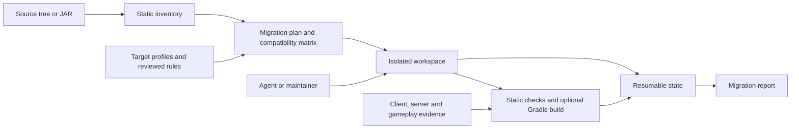

# modstride

modstride helps coding agents port existing Minecraft mods while tracking what changed and which behaviors have been verified. It inventories a source tree or JAR, plans against a target, applies reviewed configuration rules to a separate workspace, and records build and gameplay evidence. Mod maintainers can run the Python CLI without an AI service. Agents use the same CLI with a portable migration skill.



## Try the working example

From the repository root, install with Python 3.11 or later. The CLI has no third-party runtime dependencies.

```sh
python -m pip install .
modstride scan examples/sample-source-mod
modstride plan examples/sample-source-mod --to-version 1.20.4 --to-loader fabric --output-dir work/plan
modstride apply --plan work/plan/migration-plan.json --workspace work/target --dry-run
modstride apply --plan work/plan/migration-plan.json --workspace work/target
modstride verify --workspace work/target
modstride report --workspace work/target
```

The example retargets the original Copper Token mod from **Fabric 1.20.1 to 1.20.4**. The two deterministic rules update an exact Gradle property and an exact Fabric dependency declaration. The original and migrated samples built on Windows with Gradle 8.7 and JDK 17. The walkthrough records the artifact hash and provides a manual parity checklist for the item, its appearance, save and reload, and multiplayer. Client, dedicated server, and gameplay checks are still pending. [Copper Token walkthrough](examples/sample-migration/README.md)

## Migration coverage

- Fabric 1.20.1 → 1.20.4 with Mojang mappings is the demonstrated path for the conventional single-module layout and exact declarations.
- Fabric, Forge and NeoForge plans include subsystem risks and agent review tasks. Quilt is assessment-only. Exact Java and Gradle requirements still depend on the project and target.
- The scanner inventories common mapping declarations. The CLI can look up exact symbols in a supplied Tiny v2 table. Source remapping and MCP/SRG or Mojang file conversion use external tools.
- Horizon is an experimental capability assessment for semantic reimplementation. See the support matrix for coverage and prerequisites. [Supported targets](docs/supported-targets.md)

JAR scanning reads metadata, resource names and bounded class headers. Working ports require the source and its dependencies. Static scans leave dynamically computed Gradle settings, custom source layouts and ambiguous API use for review. A build establishes compiler and packaging results. Client launch, server launch, and behavior parity have separate evidence.

## Use an agent

The canonical [Agent Skill](skills/modstride/SKILL.md) works with Codex, Claude Code, Gemini CLI, Cursor, GitHub Copilot and OpenCode. Install it in the agent's discovery directory and open the mod project. Ask it to use modstride to create a sibling workspace, preserve behavior, and report build and parity evidence. [Agent setup and prompt examples](docs/agents.md)

## CLI

| Command | Output or action |
| --- | --- |
| `scan SOURCE --format json` | Inventory with confidence and evidence for environment declarations |
| `plan SOURCE --to-version VERSION --to-loader LOADER --output-dir DIR` | JSON plan, Markdown plan, and compatibility matrix |
| `apply --plan PLAN --workspace PATH [--dry-run]` | Check or create a separate copy and run eligible deterministic rules |
| `resume --workspace PATH` | Inspect progress, replay interrupted rules with `--apply`, or record reviewed evidence with `--record OPERATION PATH` |
| `verify --workspace PATH` | Run static checks and optionally a reviewed Gradle build with `--run-gradle` |
| `report --workspace PATH` | Write JSON and Markdown reports in `.modstride` |
| `rules list`, `rules show ID`, `rules validate` | Inspect rules and validate the catalogue |
| `mappings lookup TABLE --namespace NS --owner CLASS` | Inspect a symbol in a user-supplied Tiny v2 table |

See the [installation guide](docs/installation.md), [migration workflow](docs/getting-started.md), [architecture decision](docs/architecture.md), and [contributing guide](CONTRIBUTING.md).

## License

[MIT](LICENSE) covers original modstride code, documentation and the Copper Token example. Third-party mods, Minecraft, dependencies, and mapping files retain their own terms. The repository includes no redistributed Minecraft code, game assets or mappings.
